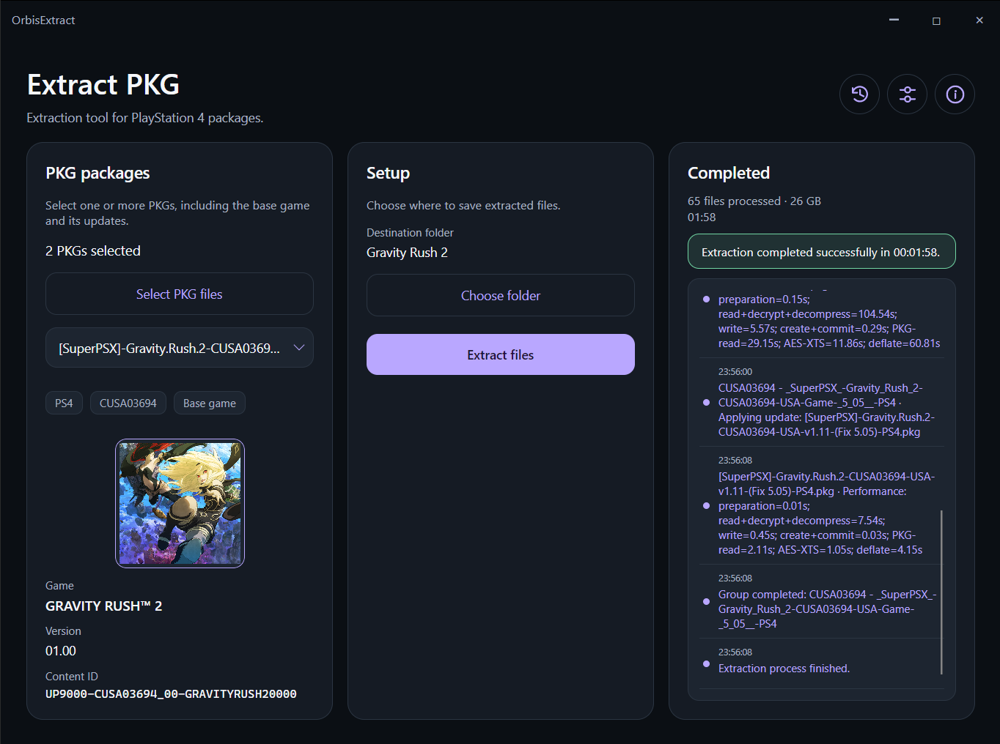
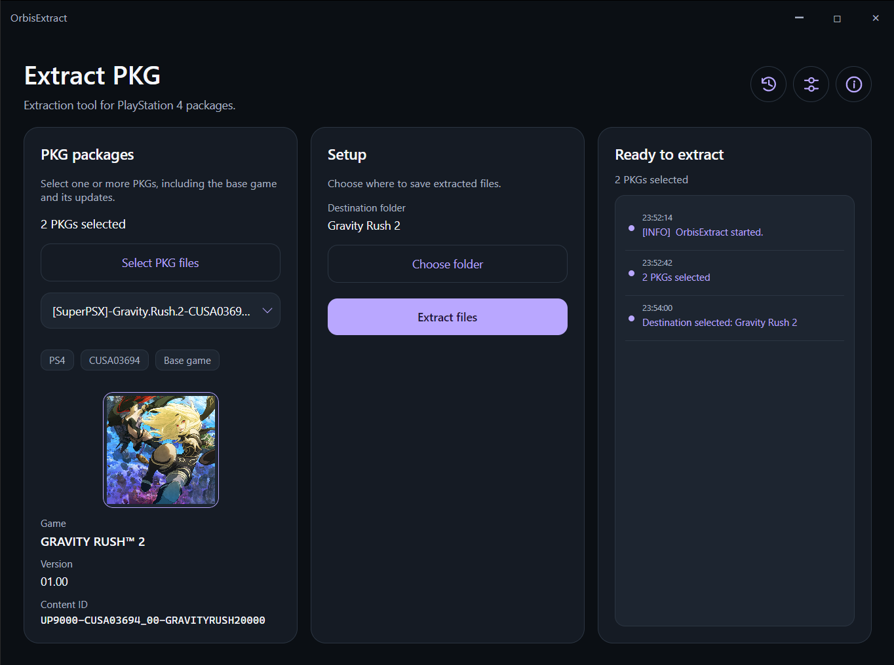
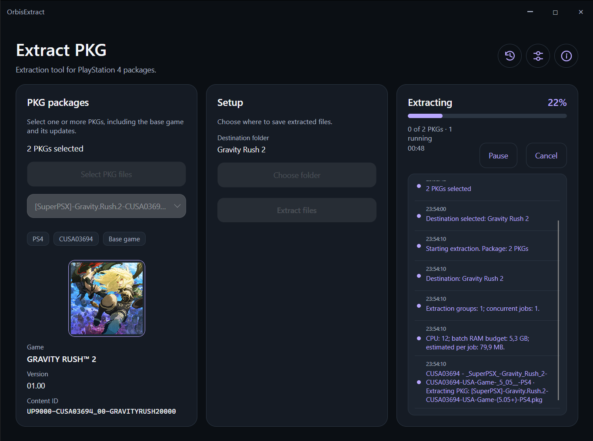
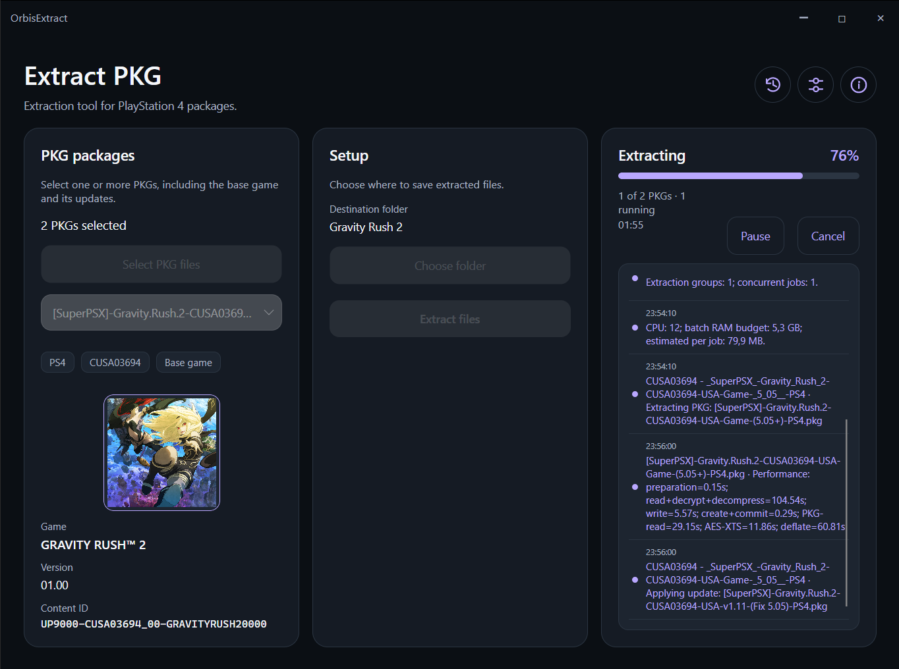

<div align="center">


# OrbisExtract

[](https://github.com/flugeru/OrbisExtract/releases/latest)

</div>

**[English](#english)** · **[Português (Brasil)](#português-brasil)**

## English

**OrbisExtract extracts the contents of PlayStation 4 game PKGs from dumps you made of your own games.** It runs on Windows, Linux and Android: select your package, inspect its game information and extract the files to a folder.

A **dump** is a copy of game data you obtained from your own PS4. OrbisExtract reads an existing dump in a compatible PKG format; it **does not dump games from your console**. Extraction produces the files inside the package, not a new PKG.

[Official website](https://flugeru.github.io/OrbisExtract/en.html) · [Support](https://flugeru.github.io/OrbisExtract/support-en.html) · [Privacy](https://flugeru.github.io/OrbisExtract/privacy-policy-en.html) · [Terms](https://flugeru.github.io/OrbisExtract/terms-en.html)

[Downloads](#downloads) · [Extraction guide](#how-to-extract-your-game-dump) · [How extraction works](#how-extraction-works) · [Gravity Rush 2 demo](#extraction-demo-gravity-rush-2) · [Troubleshooting](#troubleshooting)

### Before you start

- **A compatible PS4 game PKG.** Use a dump of your own game. To apply an update, select its PKG together with the matching base game.
- **A writable destination with enough free space.** Extracted files can take up more space than the original PKGs. Use an empty folder for a single package. On Android, grant file and folder access through the system picker; for a batch, choose a location that supports renaming folders, such as internal storage.

OrbisExtract does not supply games, make dumps from a console, install or run games, or create new PKGs. Protected or unsupported packages may not open, and the app has no passcode field.

### Downloads

**[Latest published release](https://github.com/flugeru/OrbisExtract/releases/latest)** · **[All releases](https://github.com/flugeru/OrbisExtract/releases)**

Windows x64, Linux x64 and Android 7.0+ builds are available through GitHub Releases. Test builds are available in [Actions artifacts](https://github.com/flugeru/OrbisExtract/actions/workflows/android-apk.yml) for 14 days and require GitHub sign-in.

Supported distributions: Windows x64 installer/portable, Linux x64 AppImage and Android 7.0+ APK. macOS, iOS and browser distributions are not validated. The app is not published on Google Play yet.

### What's new in 1.0.5

- **Batch extraction:** independent games extract in parallel. Select the base package and its updates together to apply versions in order.
- **Buffered extraction:** reusable buffers let the engine read and decrypt the next block while writing the current one.
- **Game preview:** shows the package title, version and artwork. When embedded artwork is unavailable, the app searches Wikimedia Commons and displays attribution.
- **Interface:** themed package picker, framed artwork, progress shown during extraction and a log that fills the card.
- **License:** GPL-3.0-only in the app and Windows installer.

[Version 1.0.5 release notes](docs/release-1.0.5.md)

### How to extract your game dump

1. Open OrbisExtract and choose **Select PKG files**. Select the base game and, if needed, its compatible update PKGs in the same batch.
2. Use the package list to check each selection. Confirm the game title, title ID (such as `CUSA03694`), package type and version before you continue.
3. Set the destination with **Choose folder**. A single PKG extracts directly into that folder; a batch creates a separate subfolder for each game group.
4. Choose **Extract files**. The status panel shows progress, elapsed time and the live log. Use **Pause** or **Cancel** if needed.
5. Check the result in the log or local history and inspect the output folder. Keep the original PKGs until you have verified the files in the tool or port that will use them.

### How extraction works

| Stage | What OrbisExtract does |
|---|---|
| **Read the package** | Reads the PKG metadata to identify the title, package type and version. The preview uses embedded artwork such as `icon0.png` or `pic1.png` when available. |
| **Plan the batch** | Matches updates to a base game by title ID, preferring a matching content ID when available. Each group processes the base first, then compatible updates in ascending `APP_VER` order. Independent game groups can run in parallel; the app limits concurrency based on CPU, available memory and storage. |
| **Extract the files** | Reads the package's embedded file system (PFS), decrypts and decompresses supported data as needed, and writes files in blocks. The output includes game files and available system metadata, such as `sce_sys/param.sfo`. The source PKGs are not modified. |
| **Apply updates and finalize** | Writes each compatible update over the matching paths in the staged base game and adds new files. The batch subfolder is finalized only after that group succeeds, without replacing an existing output folder. |

**Extraction works offline.** PKGs and their contents stay on your device. If embedded artwork is unavailable, the app can query Wikimedia Commons using the game title, not the PKG or its path. Artwork lookup and app update checks require internet access.

### Troubleshooting

| Symptom | What to check |
|---|---|
| An update is skipped or rejected | Select the matching base game in the same batch. When selecting multiple updates, use distinct, valid versions newer than the base. Binary delta updates require reconstruction and are not supported by this workflow. |
| The PKG cannot be opened | Check that you can read the file and that the copy is complete. A valid dump can still use a format or protection the app does not support. |
| Files cannot be written or the batch cannot be finalized | Check free space and write access, then try a new destination. On Android, use a storage location that supports folder renaming for batches. |
| Extraction was interrupted | Check the log and destination before retrying. A single-package extraction may leave files already written; run again in an empty folder to avoid mixing partial and fresh output. |

### Extraction demo: Gravity Rush 2

On Windows, OrbisExtract extracted the US base game (`CUSA03694`) and applied the `1.11` update to the same output in one run. The completion screen reported **65 files processed**, **26 GB**, and **1 min 58 s** for this run. Extraction time varies by hardware and storage.



<details>
<summary>See the full workflow and the packages used</summary>

- **Base game:** `[SuperPSX]-Gravity.Rush.2-CUSA03694-USA-Game-(5.05+)-PS4.pkg`
- **Update 1.11:** `[SuperPSX]-Gravity.Rush.2-CUSA03694-USA-v1.11-(Fix 5.05)-PS4.pkg`

**1. Select both PKGs and choose an output folder.**



**2. Extract the base game first.** The progress panel shows the current package and live log.



**3. Apply the update.** The log shows OrbisExtract starting the `1.11` update after extracting the base game.



</details>

#### Port compatibility: manual tests

| Title | Result |
|---|---|
| Gravity Rush 2 (`CUSA03694`, update `1.11`) | Ran successfully in [GRport](https://github.com/qnfn/GRport) with the updated files produced by OrbisExtract. |
| God of War III | Ran successfully in its port with files extracted by OrbisExtract. |

These results apply to the tested packages and port builds only. OrbisExtract extracts game files; the ports are separate projects.

### Updating the application

On Windows, run the new installer over the existing installation or replace the portable build. On Linux, download the new AppImage. Updating OrbisExtract is separate from applying a game's update PKG.

**Android updates require a compatible signing identity, the same package ID and no version-code downgrade.** New CI builds reuse the project signing key; older APKs with different signatures may require reinstallation. Preserve important app data before uninstalling. Private signing material is never included in the repository or download artifacts; public certificate details accompany the Actions APK.

Settings support system language detection or a saved Portuguese/English selection. The app checks for updates but never installs them automatically.

### Building

Use .NET SDK 8 for desktop/tests; Android requires .NET SDK 10, the `android` workload, Java 17 and Android SDK 36.

Build and test:

```sh
dotnet restore OrbisExtract.sln
dotnet build OrbisExtract.sln -c Release
dotnet test OrbisExtract.sln -c Release --no-restore
python tests/check_android_updates.py
```

| Output | Command |
|---|---|
| Windows | `powershell -ExecutionPolicy Bypass -File scripts/publish-windows.ps1` |
| Windows installer, after publishing | `ISCC packaging\windows\orbisextract.iss` — current Inno Setup 6 |
| Linux | `bash scripts/publish-linux.sh` |
| AppImage, after publishing Linux | `bash scripts/build-appimage.sh` — requires `appimagetool` |
| Local Android build | `bash scripts/publish-android.sh` |

CI requires the existing Base64 keystore in `ANDROID_SIGNING_KEYSTORE_BASE64`; missing signing material fails the build rather than silently replacing the key. Local builds need the same signing key to update CI installations.

## Português (Brasil)

O **OrbisExtract extrai o conteúdo dos PKGs de jogos de PlayStation 4**, a partir dos **dumps que você mesmo fez dos seus próprios jogos**. Funciona no Windows, Linux e Android: você seleciona o PKG, confere os dados do jogo e extrai os arquivos para uma pasta.

**Dump** é a cópia dos dados do jogo que você obteve do seu próprio PS4. O OrbisExtract trabalha com esse dump já empacotado em um PKG compatível; ele **não faz o dump do console**. O resultado da extração são os arquivos que estavam dentro do pacote, não um novo PKG.

[Site oficial](https://flugeru.github.io/OrbisExtract/) · [Suporte](https://flugeru.github.io/OrbisExtract/support.html) · [Privacidade](https://flugeru.github.io/OrbisExtract/privacy-policy.html) · [Termos de Uso](https://flugeru.github.io/OrbisExtract/terms.html)

### O que o app faz

- Abre PKGs de jogos de PS4 compatíveis e mostra título, versão e capa disponível.
- Extrai os arquivos do pacote para o destino escolhido.
- Mostra progresso, permite pausar ou cancelar e mantém log e histórico locais.
- Na versão 1.0.5, extrai jogos independentes em paralelo e integra updates compatíveis à extração do jogo base.

### O que você precisa ter

- O dump do seu próprio jogo em formato PKG compatível. O app não fornece nem baixa jogos.
- Espaço livre para o conteúdo extraído, que pode ocupar mais espaço que o PKG.
- Acesso de leitura ao pacote e de gravação à pasta de destino. No Android, você concede esse acesso pelo seletor de arquivos do sistema.

O OrbisExtract não é um emulador e não instala jogos no PS4. Não cria ou converte PKGs. Pacotes protegidos ou incompatíveis podem não ser extraídos; não há campo de passcode na interface. Ter o dump não garante que o formato ou a proteção sejam suportados.

### Downloads

**[Última versão publicada](https://github.com/flugeru/OrbisExtract/releases/latest)** · **[Releases](https://github.com/flugeru/OrbisExtract/releases)**

Builds de teste ficam nos [Artifacts do Actions](https://github.com/flugeru/OrbisExtract/actions/workflows/android-apk.yml), disponíveis por 14 dias. É necessário entrar no GitHub para baixá-los.

| Plataforma | Formato | Artefato de teste |
|---|---|---|
| Windows x64 | Instalador / portátil | `orbisextract-windows-setup` / `orbisextract-windows-exe` |
| Linux x64 | AppImage | `orbisextract-linux-appimage` |
| Android 7.0+ | APK | `OrbisExtract-Android-APK` |

macOS, iOS e navegador não têm distribuição validada. A versão Android ainda não foi publicada na Google Play.

### Novidades da 1.0.5

- **Extração em lote:** jogos independentes são processados em paralelo. Selecione a base e os updates juntos para aplicar as versões em ordem.
- **Leitura em blocos:** buffers reutilizáveis permitem ler e descriptografar o próximo bloco enquanto o atual é gravado.
- **Prévia do jogo:** mostra título, versão e capa do PKG. Quando a imagem está ausente, consulta o Wikimedia Commons e exibe a atribuição.
- **Interface:** seletor de pacotes integrado ao tema, capa com moldura, progresso visível durante a extração e log que ocupa o espaço do cartão.
- **Licença:** GPL-3.0-only no aplicativo e no instalador Windows.

[Notas da versão 1.0.5](docs/release-1.0.5.md)

### Como extrair o dump do seu jogo

1. Baixe e abra o OrbisExtract para a sua plataforma. No Windows, use o instalador ou a versão portátil. No Android, instale o APK oficial.
2. Selecione o PKG do dump do seu jogo de PS4. Confira o título, a versão e os dados disponíveis na prévia.
3. Escolha a pasta onde os arquivos serão salvos e confira o espaço livre.
4. Inicie a extração e acompanhe o progresso. Você pode pausar ou cancelar; consulte o log e o histórico para verificar o resultado.
5. Confira a saída antes de remover qualquer original. Extrações interrompidas podem deixar arquivos temporários ou parciais.

### Vários jogos e pacotes de update

Na versão 1.0.5, selecione os PKGs de todos os jogos que deseja extrair. Para integrar updates, selecione o PKG base e seus PKGs de atualização juntos. O app agrupa os pacotes compatíveis por jogo; grupos independentes são processados em paralelo, enquanto a base e seus updates são aplicados na ordem correta dentro de cada grupo.

No modo em lote, jogos independentes são extraídos em paralelo. Cada grupo usa uma subpasta própria, publicada após a extração da base e a aplicação dos updates em ordem de `APP_VER`. Pastas de destino existentes são preservadas. Updates delta binários exigem reconstrução e ficam fora dessa integração. No Android, selecione uma pasta em um provedor que permita renomear pastas, como o armazenamento interno. A prévia usa `icon0.png` ou `pic1.png` do próprio PKG quando disponível.

O limite de extrações simultâneas considera CPU, memória disponível, tamanho das imagens PFS e tipo de armazenamento. Para arquivos de 8 MiB ou mais, o motor pode ler e descriptografar o próximo bloco enquanto grava o atual, usando dois buffers reutilizáveis de 1 MiB por extração ativa.

Se o PKG não tiver arte utilizável, a prévia busca uma capa ou captura de tela no Wikimedia Commons em segundo plano. A consulta envia o título do jogo, sem enviar o arquivo, seu caminho ou seu identificador. Uma imagem encontrada mostra a autoria, a fonte e a licença. A seleção e a extração funcionam mesmo sem conexão.

### Atualizar o aplicativo

No Windows, execute o instalador novo sobre a instalação anterior ou substitua a versão portátil. No Linux, baixe o novo AppImage. Atualizar o app é diferente de aplicar um PKG de update a um jogo.

**Android:** instalar por cima exige o mesmo identificador e assinatura compatível, sem reduzir o código de versão. Builds novos usam a chave persistente do projeto; APKs antigos assinados com outras chaves podem exigir reinstalação. Preserve os dados importantes antes de desinstalar. A chave privada não fica no repositório nem nos artefatos; os dados do certificado público acompanham o APK do Actions.

Português e inglês disponíveis em Configurações, com detecção automática do sistema ou escolha manual salva. Atualizações são consultadas pelo aplicativo, mas nunca instaladas automaticamente.

### Compilar

Implementação em **C#/.NET**, com Avalonia para a interface e OpenOrbis/LibOrbisPkg para leitura dos pacotes.

Desktop e testes: **.NET SDK 8**. Android: **.NET SDK 10**, workload `android`, Java 17 e Android SDK 36.

```sh
dotnet restore OrbisExtract.sln
dotnet build OrbisExtract.sln -c Release
dotnet test OrbisExtract.sln -c Release --no-restore
python tests/check_android_updates.py
```

| Saída | Comando |
|---|---|
| Windows | `powershell -ExecutionPolicy Bypass -File scripts/publish-windows.ps1` |
| Instalador, após publicar Windows | `ISCC packaging\windows\orbisextract.iss` — Inno Setup 6 atualizado |
| Linux | `bash scripts/publish-linux.sh` |
| AppImage, após publicar Linux | `bash scripts/build-appimage.sh` — requer `appimagetool` |
| Android local | `bash scripts/publish-android.sh` |

No CI, `ANDROID_SIGNING_KEYSTORE_BASE64` deve conter o keystore existente em Base64; o build falha se o Secret estiver ausente, em vez de gerar outra chave. Não use uma chave diferente se precisar manter compatibilidade com instalações anteriores. A assinatura local precisa ser configurada com a mesma chave para produzir APKs compatíveis com os do CI.

## Credits / Créditos

- [OpenOrbis/LibOrbisPkg](https://github.com/OpenOrbis/LibOrbisPkg): package-reading library, included with local changes in `vendor/LibOrbisPkg/`, LGPL-3.0.
- [Avalonia UI](https://avaloniaui.net): cross-platform UI, MIT.

[Third-party notices](THIRD-PARTY-NOTICES.md) · [Project license: GPL-3.0-only](LICENSE) · [Prior MIT notice](PRIOR-MIT-LICENSE-NOTICE.md)
